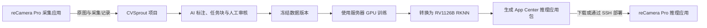

# reCamera Pro 采集与模型部署

CVSprout 可以接收 reCamera Pro 自动采集的图片，再把在项目中训练、转换的检测模型打包并部署回设备。管理员从左侧“边缘设备”进入；标注员和审核员继续使用原有项目工作流。



## 两个应用各做什么

| 应用 | App ID | 用途 |
| --- | --- | --- |
| CVSprout Capture | `cvsprout-capture` | 按间隔采集原始彩色画面，离线暂存，自动上传到绑定的项目 |
| CVSprout Inference | `cvsprout-inference` | 使用包内授权的 RKNN 检测模型推理，输出原图像素坐标检测框与类别 |

两者独立安装、启动和升级。更换推理模型不需要重新配置采集令牌。采集应用不占用 NPU，不会把推理结果框画进上传的图片。推理结果通过设备的结果通道发布，默认不烧录到视频画面中；当前版本不会把这些结果自动写成项目的人工标注。

应用包是设备 App Center 可安装的 `.tar.gz`，包含 `manifest.json`、`release.lock.json` 和 `files.sha256`。不要将普通模型 ZIP、SDK 源码压缩包或 CVSprout 的服务器推理部署包当成设备应用包安装。

## 设备和网络准备

- 设备为 **reCamera Pro / RV1126B**。RV1126、RK3576、RK3588 的 RKNN 文件不能直接混用。
- 固件需要提供 Python SDK、Kit、共享帧服务、App Center；推理应用还需要 scheduled NPU 和结果发布服务。
- 当前包的平台约定为 `rv1126b-linux-gnu-cp311-rknn232-v1`，使用固件提供的 `recamera-ai-cp311-v1`、Python 3.11 与 RKNN Runtime 2.3.2。应用不携带或替换设备的共享 Python / SDK 环境。
- **采集方向**：设备能够访问 CVSprout 的 HTTP / HTTPS 地址。设备主动上传，因此远端 CVSprout 不需要先主动访问设备。
- **直接部署方向**：CVSprout 服务器能够通过 SSH 访问设备。第一版建议使用同一局域网或 VPN；仅有设备到云服务器的上传通路，不代表云服务器可以反向部署到设备。

本机通过启动脚本运行 CVSprout 时，在 `.env` 中设置可从局域网访问的监听地址和固定端口，例如：

```dotenv
MDP_BIND_ADDRESS=0.0.0.0
MDP_PORT=8080
```

再执行 `./start.sh --strict-port`；设备中的 `server_url` 填写 `http://电脑的局域网IP:8080`。`0.0.0.0` 是监听地址，`localhost` / `127.0.0.1` 在设备上指向设备自身，都不能作为这里的服务器地址。已有端口、HTTPS 反向代理或 VPN 配置见[远程服务器使用方式](remote-server.md)。

## 连接设备并开始采集

1. 先在 CVSprout 创建接收图片的项目。打开“边缘设备”→“连接设备”，填写设备名称、项目、设备可访问的 CVSprout 地址和采集间隔。
2. 创建后，页面只显示一次该设备的 `device_token`。复制令牌和 `server_url`；关闭后无法再次查询原令牌。
3. 下载采集应用包，在设备的 App Center 上传并安装 `cvsprout-capture`。
4. 在设备应用配置填写 `server_url` 和 `device_token`，保存并启动应用。不要填写管理员 API Key 或浏览器登录密码。
5. 回到 CVSprout 设备页，等待心跳和采集记录出现。点击项目名称即可进入对应的数据页面。

设备令牌只允许访问设备配置、心跳和采集接口，上传目标由服务器绑定项目决定。修改采集设置不能把旧令牌重新绑定到其他项目；更换项目请新建接入。令牌丢失时，在设备卡片“更多”→“重置设备令牌”，然后更新设备应用配置并重启。旧令牌立即失效。

### 可调整的参数

CVSprout“采集设置”中的参数会由设备定期读取：

| 参数 | 默认值 | 行为 |
| --- | --- | --- |
| 启用新图片采集 | 开启 | 关闭后暂停新增图片，已入队图片继续上传 |
| 采集间隔 | 10 秒 | 1–86400 秒；服务端控制下一次采集节奏 |
| 最多暂存图片数 | 500 张 | 队列满时停止新增，保留尚未确认的图片 |
| 最多暂存空间 | 256 MiB | 与设备应用的本地上限共同生效，取较小值 |

设备 App Center 的采集应用参数：

| 参数 | 默认值 | 行为 |
| --- | --- | --- |
| `server_url` | 空 | CVSprout 服务地址，支持反向代理路径前缀 |
| `device_token` | 空 | 当前设备专用令牌 |
| `jpeg_quality` | 90 | JPEG 质量，范围 40–95；保留原始画面尺寸 |
| `spool_size_mb` | 128 | 本地队列上限，范围 16–512 MiB |
| `spool_max_images` | 1000 | 本地队列最多图片数，范围 10–10000 |
| `max_session_images` | 0 | 本次启动的采集总量上限；0 表示不限，应用重启后重新计数 |

设备应用参数修改后需要重启。服务端参数约每 30 秒同步一次。断网期间可沿用最近配置继续采集最多 5 分钟，此后暂停新增；恢复连接后重新同步。队列存放于设备应用的持久化 `appdata`，重启和正常应用升级后可继续补传。容量满时不会淘汰尚未确认的图片。

从采集应用 **1.0.1** 起，队列使用持久化文件，不依赖设备 Python 的 `sqlite3` 模块。每张图片与采集 ID 一起写入临时文件，刷新到存储后原子发布；仅在收到匹配的服务器回执后删除。队列参数限制待上传 JPEG 的总量，元数据和文件系统另有少量开销。磁盘写满时保留未确认记录，暂停新增；释放空间后继续。

### 采集应用提示缺少 sqlite3

若 1.0.0 启动时报 `ModuleNotFoundError: No module named 'sqlite3'`，请下载 **1.0.1 或更高版本**的采集应用包，在设备 App Center 中升级原 `cvsprout-capture`，确认原 `server_url` 和 `device_token` 配置后启动。CVSprout 更新源码后，设备页下载的采集包也会使用新版本；Docker 部署需重新构建并启动 Web 镜像。该修复不需要给设备安装 Python 依赖或升级推理应用。

此报错发生在模块导入时，该次启动尚未创建本地队列。若设备以前曾成功运行 1.0.0、已有 `captures.sqlite3` 或相关日志文件，新版会保留旧文件并明确提示需要迁移，避免悄悄遗留待上传图片。升级前应先在支持旧版的原运行环境中关闭新增采集、等待队列排空，并备份旧队列；旧文件的处理与迁移说明见采集应用包内 `README.md`。不要直接删除仍有待上传图片的旧队列。

## 去重、溯源与协作标注

每次采集有固定的 `capture_id`；网络失败重试时不重新生成 ID。CVSprout 原子保存图片和回执，只有收到同一 ID 的有效接收确认后，设备才删除本地队列记录。因此重复发送同一条采集记录不会创建多份数据。

项目内使用 SHA-256 合并内容完全相同的图片，同时保留每一次独立的采集事件。设备页的“收到的采集记录”与“关联的项目图片”可能不同：例如一张静态画面被采集多次，会对应多条来源记录和一份图片。记录包含采集 ID、图片、采集时间、接收时间及可选批次 / 模型版本。内容去重不是相似图去重，也不是自动剔除没有目标的图片。

新导入图片保持未分配状态，由管理员创建新的任务块。系统不会把新图片追加到已经领取的块，也不会改写已完成标注。管理员可以先做 AI 预标注再分块，或先分块后让领取人处理自己的未完成图片。标注、审核、冻结数据版本和训练沿用[任务块协作流程](user-guide.md#任务块协作)。

“撤销接入”要求输入完整设备名称确认，随后禁止设备继续认证和上传。已导入图片、采集溯源记录保留。归档的项目暂停接收设备图片；需要继续采集时恢复项目。删除项目仍遵守已有的项目删除确认和任务保护规则。

## 把自己的模型部署回设备

1. 在项目中完成审核，创建数据版本并训练目标检测模型。
2. 在“训练与转换”选择完成的训练，点击“转换并导出”，选择 **RKNN → RV1126B**。首次建议先使用不量化的 FP16 检查转换通路；INT8 使用该训练冻结版本的训练集校准。
3. 转换完成后，进入“边缘设备”→目标设备的“模型部署”。选择兼容的转换结果，点击“生成应用包”。页面会列出不兼容结果及原因。
4. 生成的推理应用包包含 RKNN、类别顺序、输入输出约定、来源训练与转换 ID、模型与包校验值。可以下载后在设备 App Center 手动安装，也可以继续填写设备 IP、SSH 用户和端口，由 CVSprout 部署。
5. 若设备已有正在运行的推理应用，确认允许短暂停止后，再勾选“允许停止并替换此应用”。安装后应用自动启动，页面显示任务状态与最终阶段、结果。

首次交付的推理包内含本项目实际训练的 **YOLO26n / person 单类别模型**，用于验证分发通路。用户后续生成的包使用所选训练和转换的真实模型，不会继续使用这个初始模型。

### 哪些模型可以打包

当前支持 YOLOv8、YOLO11、YOLO26 的已适配目标检测输出，同时检查实际转换元数据：

- 单张静态输入 `1×3×S×S`，正方形尺寸为 32 的倍数。
- RGB、letterbox、填充值 114，RKNN 内置 `mean=0/std=255`；设备传入原始 `uint8`，不重复归一化。
- 明确关闭端到端输出与图内 NMS，单输出为 `[1, 4+类别数, 候选框数]`，坐标格式为已解码 `xywh`。
- 目标芯片为 RV1126B，类别名称连续、有序且与输出通道一致。

应用在设备侧执行 NMS、还原 letterbox 坐标，并输出原图像素 `xyxy`。仅有 `.rknn` 扩展名或名字中包含 YOLO 并不能证明兼容。当前分割、分类、关键点、RT-DETR、其他芯片或其他输出布局会显示具体的不可部署原因。

模型是应用包内带校验信息的授权产物。更新模型需要生成并安装新应用包，不能直接覆盖设备安装目录中的 RKNN 文件。应用源码许可证不改变模型自身的许可条件，详见每个包中的 `MODEL_PROVENANCE.md`。

### 服务器的 SSH 配置

直接部署使用 CVSprout 服务器上的 SSH 客户端、专用密钥或 SSH agent，以及已确认的设备主机密钥。浏览器不接收 SSH 私钥或密码，也不允许输入远程脚本。

```dotenv
MDP_RECAMERA_SSH_KEY=/path/to/recamera_deploy_key
MDP_RECAMERA_KNOWN_HOSTS=/path/to/recamera_known_hosts
```

`MDP_RECAMERA_KNOWN_HOSTS` 应指向已核对设备指纹的 OpenSSH `known_hosts` 文件。私钥仅对运行 CVSprout 的服务账号可读；使用已经配置好的 SSH agent 时可不设置私钥路径。重启服务使配置生效。运行在 Docker 中时，这些路径必须是**容器内可读的路径**，并以只读方式挂载对应文件；仅修改宿主机 `.env` 不会自动挂载密钥文件。

Docker 安装可以使用提供的 SSH 配置覆盖文件。先在一个受保护的目录准备 `id_ed25519` 和 `known_hosts`，确保容器中的服务 UID `10001` 可以读取，然后执行：

```bash
RECAMERA_SSH_DIR=/private/recamera-ssh docker compose \
  -f compose.yaml -f deploy/recamera/compose.ssh.yaml up -d --build
```

原来使用 GPU 模式时，同时保留 GPU 配置：

```bash
RECAMERA_SSH_DIR=/private/recamera-ssh docker compose \
  -f compose.yaml -f compose.gpu.yaml -f deploy/recamera/compose.ssh.yaml up -d --build
```

将示例目录替换为实际目录；覆盖文件将整个目录只读挂载到 Web 服务的 `/run/recamera-ssh`，并配置对应的容器内路径。以后更新、重建时继续使用相同的 Compose 文件组合，才能保留 SSH 挂载。

CVSprout 通过 SSH 向设备传输包，再调用设备官方 App Center 的策略检查、上传、预检、安装操作、启动和状态接口。安装请求被接受不等于应用已运行，页面会继续检查结果。设备的签名与安装策略仍生效；不能以此绕过固件的发布限制。连接中断导致结果不确定时，先到设备应用中心核实，再决定是否重新部署。

## 常见问题

| 现象 | 检查方法 |
| --- | --- |
| 一直显示“等待首次连接” | 确认应用已启动；检查 `server_url` 使用真实服务器地址，端口与防火墙允许设备连接，令牌已保存 |
| 心跳正常但没有新图片 | 检查是否暂停采集、达到本次启动配额或离线队列已满，以及项目是否归档 |
| 图片数量少于采集记录 | 查看采集记录是否提示已有关联图片；内容相同的图片只保留一份 |
| 重置令牌后不再上传 | 更新设备应用的 `device_token` 并重启；旧令牌已经失效 |
| 没有可部署的模型 | 先完成 RKNN 转换，目标选择 RV1126B；在对话框展开不兼容原因 |
| “部署到设备”不可点击 | 先生成并选择应用包，再由管理员配置 SSH 客户端及可信主机文件；有未结束部署时需要先确认其结果 |
| SSH 能连接但 App Center 拒绝安装 | 查看部署错误和设备应用中心的预检 / 签名 / 运行资源提示，按设备当前固件策略处理 |
| 推理框或类别不正确 | 比对包内类别顺序与模型约定，在设备用已知验证图片检查预处理、坐标还原与检测结果 |

## 源码、验证与当前边界

CVSprout 接口代码位于 `app/edge.py` 及 `app/recamera_*.py`，页面为 `static/edge-devices-ui.js`。用于重复生成应用包的模板和固定版本官方打包器位于 `deploy/recamera/`，正常打包不依赖开发者电脑上的 SDK 绝对路径。

两个设备应用的完整开发源码位于 `seeed-recamera-pro-ext-api` 仓库的 `apps/cvsprout-capture/`、`apps/cvsprout-inference/`；对应验证方法见该仓库 `tests/cvsprout/README.md`。设备包通过官方打包器生成，校验权限、产物哈希、文件清单和发布锁定信息。

本次验证包含主机端 API / 浏览器流程、队列与重复请求、包结构校验、受控 Kit 加载与推理输出。没有提供目标设备连接信息，因此**没有把主机或模拟测试记为真机验收**。在实际上线前，还需要在所用固件上确认共享帧、scheduled NPU、App Center 安装启动、持续上传、重启补传、模型精度与性能。包内 `board_validated=false` 表示尚未完成该模型的设备验收。

当前设备管理负责单设备采集接入与按设备发布检测模型；跨 NAT 的自动部署代理、批量灰度发布、设备预测自动回流标注和自动按时间分块尚未包含在此版本。

应用打包在 Linux / Docker 环境验证。Windows 用户请使用 Docker 或 WSL2 运行打包服务，避免官方打包器在原生 Windows 下的归档路径分隔符差异。当前推理包支持最大 180 MiB 的 RKNN 文件；量化与模型精度仍需分别验收。
