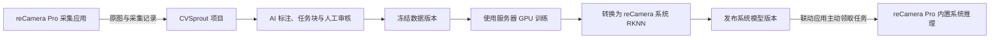

# reCamera Pro 采集与模型部署

CVSprout 可以接收 reCamera Pro 自动采集的图片，再将项目中训练、转换的检测模型发布到设备系统模型库，并按需启用系统推理。管理员在左侧“边缘设备”管理连接与采集，在项目“训练与部署”中选择模型并部署；其他成员继续使用原有项目工作流。



## 一个联动应用与设备系统推理

新接入只需安装 **CVSprout Connector 1.1.0 联动应用**，沿用 App ID `cvsprout-capture`。它负责原图采集、离线暂存、上传、接收模型部署任务，以及上报设备系统模型能力和运行状态。现有采集连接、令牌和队列沿用，不要求另装 `cvsprout-inference`。

模型由设备已有的内置系统推理执行。发布新模型不重新安装联动应用，也不把训练权重塞进应用安装包。应用包升级与模型版本发布是两个独立操作；采集不占用 NPU，不会把检测框烧录进上传原图。系统推理结果目前不会自动写成项目的人工标注。

旧版 `cvsprout-inference` 安装包及部署记录继续保留，可从设备卡片“更多”中的“旧版应用部署记录”查看。旧版自带后处理的 RKNN 与系统模型格式不同，不能互相冒充兼容。

联动应用安装包是 App Center 可安装的 `.tar.gz`，含 `manifest.json`、`release.lock.json` 和 `files.sha256`。系统模型版本则保存 RKNN、模型元数据与校验值，通过设备官方模型管理接口导入。

## 设备和网络准备

- 设备为 **reCamera Pro / RV1126B**。RV1126、RK3576、RK3588 的 RKNN 文件不能直接混用。
- 固件需要提供 Python SDK、Kit、共享帧服务、App Center。系统部署还要求设备官方模型管理接口可用，且联动应用获得调用权限；未完成配置时页面会说明缺少的能力。
- 当前包的平台约定为 `rv1126b-linux-gnu-cp311-rknn232-v1`，使用固件提供的 `recamera-ai-cp311-v1`、Python 3.11 与 RKNN Runtime 2.3.2。应用不携带或替换设备的共享 Python / SDK 环境。
- **采集方向**：设备能够访问 CVSprout 的 HTTP / HTTPS 地址。设备主动上传，因此远端 CVSprout 不需要先主动访问设备。
- **系统模型部署方向**：联动应用主动联系 CVSprout、领取任务并下载模型，可沿用图片上传的出站网络通路。CVSprout 不需要反向 SSH 到设备；旧版独立推理应用部署仍使用原 SSH 流程。

访问 CVSprout 的 HTTPS 地址时，联动应用正常校验证书链和服务器名称；请为平台配置设备信任且与域名匹配的证书。设备本机系统模型接口若从 HTTP 跳转 HTTPS，Connector 只接受回环地址，并读取固件的公开证书 `/userdata/config/system/ssl/server.crt` 校验证书链、有效期及服务端证书指纹，不读取私钥或内部系统密钥。公开证书缺失、过期或与接口返回证书不符时，系统能力上报会显示接口不可用；采集上传独立运行。不要通过关闭 TLS 校验解决证书问题。

本机通过启动脚本运行 CVSprout 时，在 `.env` 中设置可从局域网访问的监听地址和固定端口，例如：

```dotenv
MDP_BIND_ADDRESS=0.0.0.0
MDP_PORT=8080
```

再执行 `./start.sh --strict-port`；设备中的 `server_url` 填写 `http://电脑的局域网IP:8080`。`0.0.0.0` 是监听地址，`localhost` / `127.0.0.1` 在设备上指向设备自身，都不能作为这里的服务器地址。已有端口、HTTPS 反向代理或 VPN 配置见[远程服务器使用方式](remote-server.md)。

## 连接设备并开始采集

1. 先在 CVSprout 创建接收图片的项目。打开“边缘设备”→“连接设备”，填写设备名称、项目、设备可访问的 CVSprout 地址和采集间隔。
2. 创建后，页面只显示一次该设备的 `device_token`。点击“复制令牌”，确认显示“设备令牌已复制”，再粘贴到设备配置；同时填写 `server_url`。局域网 HTTP 地址也支持按钮复制；若浏览器阻止复制，页面会明确提示，此时勾选“显示令牌”并手动复制完整内容。关闭后无法再次查询原令牌。
3. 下载联动应用包，在设备的 App Center 上传并安装或升级 `cvsprout-capture`。
4. 在设备应用配置填写 `server_url` 和 `device_token`，保存并启动应用。不要填写管理员 API Key 或浏览器登录密码。
5. 回到 CVSprout 设备页，等待心跳和采集记录出现。点击项目名称即可进入对应的数据页面。

`device_token` 必须完整复制，以 `cvsprout_device_` 开头；不要填写网页登录密码、设备 ID、SSH 密码或管理员 API Key。设备令牌仅用于当前接入的配置、心跳、采集上传，以及系统模型能力与状态上报、任务领取和租约续期、已授权任务的模型下载与结果回报；不能用于管理员或其他设备的接口。上传目标与可领取的模型任务由服务器绑定设备和项目决定。修改采集设置不能把旧令牌重新绑定到其他项目；更换项目请新建接入。令牌丢失时，在设备卡片“更多”→“重置设备令牌”，然后更新设备应用配置并重启。旧令牌立即失效。

### 查看采集图片

点击设备卡片的“采集记录”，可查看每张图片的缩略图、采集时间、收到时间和采集 ID。点击缩略图查看原图；点击“返回记录”或在预览内按 `Esc`，保留原来的分页位置和焦点。点击文件名或预览中的“前往标注”可打开对应图片。

相同图片的多次采集仍分别显示记录和采集时间。图片已从项目删除时显示“原图已删除”，历史记录保留；网络或图片文件异常时显示“图片暂不可用”。缩略图和原图沿用网页登录权限，不需要在图片地址中携带设备令牌。

### 如何确认连接和上传成功

创建接入或开启采集开关表示已保存设置，不代表设备已经连接。页面可见时每 **5 秒**刷新状态，首次配置窗口会在设备使用有效令牌联系服务器后显示“已确认设备连接成功”，无需先关闭令牌窗口。后台刷新不会覆盖正在填写的设置或收起已展开的菜单。

| 页面状态 | 含义与处理方式 |
| --- | --- |
| 尚未连接 | 还没有收到设备的有效请求。检查采集应用已启动、服务地址可访问，以及设备专用令牌是否完整保存。 |
| 在线 · 已连接 | 服务器最近 90 秒内收到过认证成功的配置请求、心跳或图片上传。还需查看下方采集状态确认图片是否已到达。 |
| 离线 · 联系已超时 | 超过 90 秒没有有效联系。检查设备应用和网络；之前收到的图片不会删除。 |
| 等待使用新令牌连接 | 令牌已重置，等待设备保存新令牌并重新认证。历史心跳不能证明新配置有效。 |
| 连接状态待确认 | 浏览器暂时无法刷新服务器状态，保留上次数据，不继续显示“在线”。 |

卡片分别显示采集设置、最近联系、最近心跳、最近收到图片、应用版本、累计采集记录和待上传数量。采集状态会进一步区分等待第一张图片、等待相机画面、图片等待上传、暂停、队列已满、达到本次采集上限和具体故障。有历史图片但超过 `max(90 秒, 采集间隔 × 3)` 未收到新图片时，会提示近期没有收到新图片。

从采集应用 **1.0.2** 起（包括 Connector **1.1.0**），每 15 秒上报心跳，即使暂时没有相机帧也会联系服务器。新版服务器仍兼容 1.0.1；新版应用会按服务器声明发送诊断字段，也兼容旧版服务器。旧版应用未提供的帧数等信息不会被推测为正常。

### 应用在运行但没有图片

先查看设备 App Center 的采集应用日志。`frame#… dets=0 events=0 clients=0` 是 Kit 视频帧日志，`clients=0` 不是 CVSprout 上传连接数；采集应用本身不做检测，因此 `dets=0` 也不是上传失败。

1. `device_token_invalid` 或 `configuration: http_401`：令牌格式错误、已失效或不属于此服务。在 CVSprout 设备卡片重置令牌，完整复制到设备应用配置，保存并重启。尚未通过认证的设备无法把自己的错误心跳写入项目，页面此时只能提示“尚未连接”。
2. `server_dns_failed`、`server_connection_refused`、`server_timeout`：检查设备网络、服务器监听地址、端口和防火墙；`server_tls_verification_failed` 表示需要检查 HTTPS 证书。
3. `connection: server_configuration_received`、`heartbeat: server_confirmed` 表示认证和联系已成功。若页面持续等待相机画面，检查设备预览及帧服务。
4. `capture: first_image_queued` 表示图片已在本地排队，`upload: first_image_confirmed` 才表示服务器确认收到。若持续排队，查看页面的最近错误及设备上传日志；不要删除未确认的缓存图片。

这些日志不包含设备令牌；请勿在共享日志或截图中展示应用配置里的明文凭据。

### 可调整的参数

CVSprout“采集设置”中的参数会由设备定期读取：

| 参数 | 默认值 | 行为 |
| --- | --- | --- |
| 启用新图片采集 | 开启 | 关闭后暂停新增图片，已入队图片继续上传 |
| 采集间隔 | 10 秒 | 1–86400 秒；服务端控制下一次采集节奏 |
| 最多暂存图片数 | 500 张 | 队列满时停止新增，保留尚未确认的图片 |
| 最多暂存空间 | 256 MiB | 与设备应用的本地上限共同生效，取较小值 |

设备 App Center 的采集应用参数：

| 参数 | 默认值 | 行为 |
| --- | --- | --- |
| `server_url` | 空 | CVSprout 服务地址，支持反向代理路径前缀 |
| `device_token` | 空 | 当前设备专用令牌 |
| `jpeg_quality` | 90 | JPEG 质量，范围 40–95；保留原始画面尺寸 |
| `spool_size_mb` | 128 | 本地队列上限，范围 16–512 MiB |
| `spool_max_images` | 1000 | 本地队列最多图片数，范围 10–10000 |
| `max_session_images` | 0 | 本次启动的采集总量上限；0 表示不限，应用重启后重新计数 |

设备应用参数修改后需要重启。服务端参数约每 30 秒同步一次。断网期间可沿用最近配置继续采集最多 5 分钟，此后暂停新增；恢复连接后重新同步。队列存放于设备应用的持久化 `appdata`，重启和正常应用升级后可继续补传。容量满时不会淘汰尚未确认的图片。

从采集应用 **1.0.1** 起，队列使用持久化文件，不依赖设备 Python 的 `sqlite3` 模块。每张图片与采集 ID 一起写入临时文件，刷新到存储后原子发布；仅在收到匹配的服务器回执后删除。队列参数限制待上传 JPEG 的总量，元数据和文件系统另有少量开销。磁盘写满时保留未确认记录，暂停新增；释放空间后继续。

### 采集应用提示缺少 sqlite3

若 1.0.0 启动时报 `ModuleNotFoundError: No module named 'sqlite3'`，请下载 **1.0.1 或更高版本**的采集应用包，在设备 App Center 中升级原 `cvsprout-capture`，确认原 `server_url` 和 `device_token` 配置后启动。CVSprout 更新源码后，设备页下载的采集包也会使用新版本；Docker 部署需重新构建并启动 Web 镜像。该修复不需要给设备安装 Python 依赖或升级推理应用。

此报错发生在模块导入时，该次启动尚未创建本地队列。若设备以前曾成功运行 1.0.0、已有 `captures.sqlite3` 或相关日志文件，新版会保留旧文件并明确提示需要迁移，避免悄悄遗留待上传图片。升级前应先在支持旧版的原运行环境中关闭新增采集、等待队列排空，并备份旧队列；旧文件的处理与迁移说明见采集应用包内 `README.md`。不要直接删除仍有待上传图片的旧队列。

## 去重、溯源与协作标注

每次采集有固定的 `capture_id`；网络失败重试时不重新生成 ID。CVSprout 原子保存图片和回执，只有收到同一 ID 的有效接收确认后，设备才删除本地队列记录。因此重复发送同一条采集记录不会创建多份数据。

项目内使用 SHA-256 合并内容完全相同的图片，同时保留每一次独立的采集事件。设备页的“收到的采集记录”与“关联的项目图片”可能不同：例如一张静态画面被采集多次，会对应多条来源记录和一份图片。记录包含采集 ID、图片、采集时间、接收时间及可选批次 / 模型版本。内容去重不是相似图去重，也不是自动剔除没有目标的图片。

新导入图片保持未分配状态，由管理员创建新的任务块。系统不会把新图片追加到已经领取的块，也不会改写已完成标注。管理员可以先做 AI 预标注再分块，或先分块后让领取人处理自己的未完成图片。标注、审核、冻结数据版本和训练沿用[任务块协作流程](user-guide.md#任务块协作)。

“撤销接入”要求输入完整设备名称确认，随后禁止设备继续认证和上传。已导入图片、采集溯源记录保留。归档的项目暂停接收设备图片；需要继续采集时恢复项目。删除项目仍遵守已有的项目删除确认和任务保护规则。

联动应用仍只需填写原有 `server_url` 与 `device_token`，不新增设备管理员账号、密码或远程系统 API 地址。系统模型操作使用设备本机官方模型接口；若固件接口或本机授权不可用，页面会显示能力错误，采集上传继续独立运行。不要通过修改模型目录或配置内部系统密钥来绕过权限。

## 把自己的模型部署回设备

1. 在项目中完成审核、创建数据版本，训练 **YOLOv8 或 YOLO11 目标检测模型**。
2. 打开项目“训练与部署”→“转换并导出”，选择 **RKNN → reCamera Pro 系统模型**。该用途固定 RV1126B、INT8、RGB 均值 0 / 标准差 255，并使用该训练冻结版本的训练集校准。通用 RKNN 默认设置不会自动改动；切回通用用途会恢复原设置。
3. 在同一训练记录的“转换与部署”页签，找到已完成的系统模型转换，点击“部署到设备”。选择绑定当前项目且在线的设备；只有一台可用设备时自动选中。离线、尚未连接或已撤销的设备不可选择，没有可用设备时先到“边缘设备”配置连接。
4. 确认模型和设备，可修改“模型名称”，然后选择 **仅加入模型库** 或 **部署并启用**，点击底部部署按钮即可。平台自动校验并准备模型版本，已有版本会复用，无需单独点击发布或再次选择模型。启用需要勾选允许替换当前系统推理模型；目标 FPS 默认沿用设备当前设置，可展开“高级设置”修改。设备能力、当前模型和校验信息可展开“设备状态与模型详情”查看。
5. 窗口顶部显示部署进度，每 5 秒自动更新：等待设备领取 → 下载模型 → 导入模型库；选择启用时继续显示启用模型 → 验证运行。进度条表示实际完成的阶段数，不代表文件传输百分比。仅入库完成显示“已加入系统模型库”；启用必须收到设备验证成功后才显示“已验证系统推理运行”。失败、联系超时或刷新失败会显示对应说明，并保留上次结果。
6. 关闭窗口不会停止部署。可以再次从同一转换记录进入，或到设备卡片“更多”→“系统模型状态与记录”继续查看进度。展开“部署记录”可取消未领取任务或核实未知结果；设备记录入口不发起新部署。

设备离线时，已具备部署能力的接入可以保留等待任务；恢复连接后自动领取。尚未领取的任务可取消。正在执行或结果未知的任务需要先核实设备状态，不能盲目重复部署。租约过期后可使用“核实并解除占用”：先在设备核实模型状态并停止原部署操作，再输入完整设备名称并确认；平台只将任务标记失败并释放部署槽位，不会回滚模型或停止设备操作。页面刷新失败后会保留历史信息，同时标明系统状态待确认。

模型名称默认包含算法、训练记录和转换编号，例如 `yolo11-run7-conv5`。可使用 1–64 位英文字母、数字、下划线或连字符，首位须为字母或数字；留空恢复默认，无需输入 `.rknn`。平台自动追加发布版本编号，例如 `factory-detector-r12.rknn`，此名称会显示在设备模型库及部署记录中。同一发布版本可以用不同名称部署，原始发布文件和已有部署记录保持不变；不同版本即使使用相同名称也会得到不同文件名。

### 系统模型兼容范围

当前系统转换首期支持 YOLOv8、YOLO11 **目标检测**，采用设备系统推理后处理所需的专用输出格式，目标 RV1126B、INT8、固定单图输入和有序类别。发布过程同时校验转换元数据与设备上报的算法能力。普通 RKNN、旧版单输出推理应用模型、YOLO26、分类、分割、姿态、OBB 或其他芯片不能直接作为此系统模型发布；页面显示不兼容原因，不靠文件名猜测。

“通用 RKNN”继续面向自备推理程序，允许原有芯片、精度和预处理设置。系统用途的校准数据、实际准确率和性能仍需在目标设备上验收。模型许可证与代码许可证分别适用。

### 旧版独立推理应用

旧版应用包与 SSH 安装记录仍可从设备卡片“更多”→“旧版应用部署记录”或部署窗口底部进入。旧包支持已适配的 YOLOv8 / YOLO11 / YOLO26 单输出检测契约，包内带独立解码与 NMS；它不等于新的系统模型发布格式。既有安装无需被自动删除或替换。

以下 SSH 配置仅用于旧版应用安装，不是系统模型联动的前提。

### 服务器的 SSH 配置

直接部署使用 CVSprout 服务器上的 SSH 客户端、专用密钥或 SSH agent，以及已确认的设备主机密钥。浏览器不接收 SSH 私钥或密码，也不允许输入远程脚本。

```dotenv
MDP_RECAMERA_SSH_KEY=/path/to/recamera_deploy_key
MDP_RECAMERA_KNOWN_HOSTS=/path/to/recamera_known_hosts
```

`MDP_RECAMERA_KNOWN_HOSTS` 应指向已核对设备指纹的 OpenSSH `known_hosts` 文件。私钥仅对运行 CVSprout 的服务账号可读；使用已经配置好的 SSH agent 时可不设置私钥路径。重启服务使配置生效。运行在 Docker 中时，这些路径必须是**容器内可读的路径**，并以只读方式挂载对应文件；仅修改宿主机 `.env` 不会自动挂载密钥文件。

Docker 安装可以使用提供的 SSH 配置覆盖文件。先在一个受保护的目录准备 `id_ed25519` 和 `known_hosts`，确保容器中的服务 UID `10001` 可以读取，然后执行：

```bash
RECAMERA_SSH_DIR=/private/recamera-ssh docker compose \
  -f compose.yaml -f deploy/recamera/compose.ssh.yaml up -d --build
```

原来使用 GPU 模式时，同时保留 GPU 配置：

```bash
RECAMERA_SSH_DIR=/private/recamera-ssh docker compose \
  -f compose.yaml -f compose.gpu.yaml -f deploy/recamera/compose.ssh.yaml up -d --build
```

将示例目录替换为实际目录；覆盖文件将整个目录只读挂载到 Web 服务的 `/run/recamera-ssh`，并配置对应的容器内路径。以后更新、重建时继续使用相同的 Compose 文件组合，才能保留 SSH 挂载。

CVSprout 通过 SSH 向设备传输包，再调用设备官方 App Center 的策略检查、上传、预检、安装操作、启动和状态接口。安装请求被接受不等于应用已运行，页面会继续检查结果。设备的签名与安装策略仍生效；不能以此绕过固件的发布限制。连接中断导致结果不确定时，先到设备应用中心核实，再决定是否重新部署。

## 常见问题

| 现象 | 检查方法 |
| --- | --- |
| 一直显示“等待首次连接” | 确认应用已启动；检查 `server_url` 使用真实服务器地址，端口与防火墙允许设备连接，令牌已保存 |
| 心跳正常但没有新图片 | 检查是否暂停采集、达到本次启动配额或离线队列已满，以及项目是否归档 |
| 图片数量少于采集记录 | 查看采集记录是否提示已有关联图片；内容相同的图片只保留一份 |
| 重置令牌后不再上传 | 更新设备应用的 `device_token` 并重启；旧令牌已经失效 |
| 没有可部署的系统模型 | 使用 YOLOv8 / YOLO11 检测训练，转换用途选“reCamera Pro 系统模型”；展开转换兼容性查看原因 |
| 系统部署不可点击 | 检查联动应用能力报告、发布的模型版本和未结束任务；启用模式还需要确认替换当前模型 |
| SSH 能连接但 App Center 拒绝安装 | 查看部署错误和设备应用中心的预检 / 签名 / 运行资源提示，按设备当前固件策略处理 |
| 推理框或类别不正确 | 比对包内类别顺序与模型约定，在设备用已知验证图片检查预处理、坐标还原与检测结果 |

## 源码、验证与当前边界

CVSprout 采集接口位于 `app/edge.py`，系统模型发布和部署接口位于 `app/edge_models.py`，设备系统格式导出位于 `app/recamera_export.py`，页面为 `static/edge-devices-ui.js`。用于重复生成应用包的模板和固定版本官方打包器位于 `deploy/recamera/`，正常打包不依赖开发者电脑上的 SDK 绝对路径。

Connector 的完整源码位于 `seeed-recamera-pro-ext-api` 仓库的 `apps/cvsprout-capture/`；旧版独立推理应用保留在 `apps/cvsprout-inference/`。对应验证方法见该仓库 `tests/cvsprout/README.md`。设备包通过官方打包器生成，校验权限、产物哈希、文件清单和发布锁定信息。

本次验证包含主机端 API / 浏览器流程、队列与重复请求、包结构校验、受控 Kit 加载与推理输出。各项主机或模拟测试均不替代目标固件上的模型运行验收。在实际上线前，还需要在所用固件上确认共享帧、scheduled NPU、App Center 安装启动、持续上传、重启补传、模型精度与性能。包内 `board_validated=false` 表示尚未完成该模型的设备验收。

当前设备管理负责单设备采集接入和系统模型任务领取，支持已有出站连接的远程设备。批量灰度发布、设备预测自动回流标注和自动按时间分块尚未包含在此版本。

应用打包在 Linux / Docker 环境验证。Windows 用户请使用 Docker 或 WSL2 运行打包服务，避免官方打包器在原生 Windows 下的归档路径分隔符差异。当前推理包支持最大 180 MiB 的 RKNN 文件；量化与模型精度仍需分别验收。
